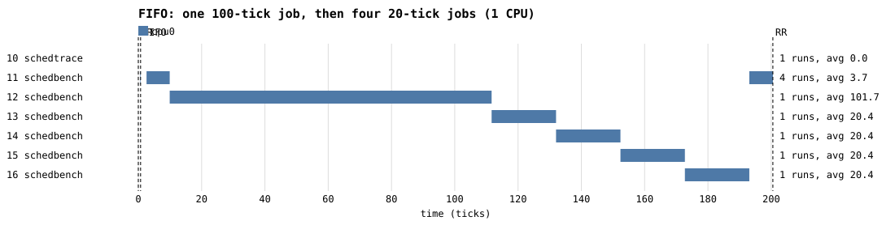
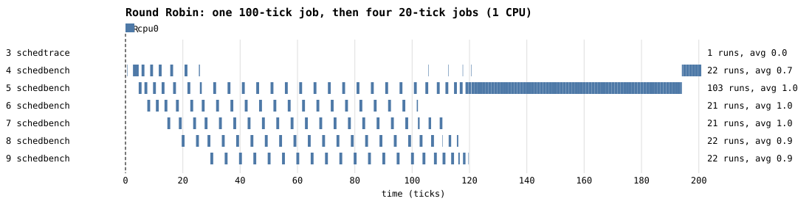
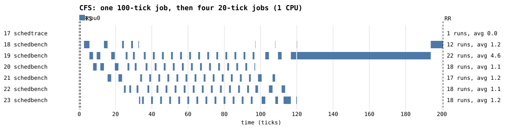

# Pluggable Schedulers for xv6: RR, FIFO and CFS

This fork of xv6 (x86) replaces the fixed round-robin scheduler with three
**scheduling classes** that can be switched **at runtime, without rebooting**:

| Scheduler | `schedctl` | Preemption | Picks next | Run-queue cost |
|---|---|---|---|---|
| Round Robin | `rr` | every tick (1-tick quantum) | head of a FIFO list | O(1) |
| FIFO | `fcfs` / `fifo` | **none** (runs until it blocks or exits) | process that became ready first | O(1) |
| Completely Fair Scheduler | `cfs` | when its time slice is used up | smallest virtual runtime (leftmost red-black-tree node) | O(log n) |

CFS supports **nice values** (−20..19) with the Linux weight table, and
time slices derived from the **`sched_latency`** and **`min_granularity`**
tunables. Everything is verified by an automated test suite (unit, mutation,
in-kernel invariant checking, randomised stress, xv6's own usertests) that
runs with one command and in GitHub Actions.

The system boots with RR, so stock xv6 behaviour is unchanged until you switch.

---

## 1. Quick start

```sh
make qemu-nox                 # boot xv6 (2 CPUs)
make qemu-nox CPUS=1          # 1 CPU: scheduling effects are easiest to see
make qemu-bench CPUS=1        # deterministic clock, for benchmarks (§7.1)

make test                     # quick automated suite (~1 min)
make test-full                # everything incl. usertests + benchmarks (results/)
make SCHED_DEBUG=1 qemu-nox   # kernel that checks scheduler invariants constantly
```

Inside xv6:

```
$ schedctl get                    # active scheduler and CFS tunables
$ schedctl cfs                    # switch (rr | fcfs | fifo | cfs)
$ schedctl tune 12 2              # CFS sched_latency = 12, min_granularity = 2 ticks
$ nice 5 ps                       # run a command at nice 5
$ renice -3 7                     # change the nice value of pid 7
$ ps                              # per-process state, nice, vruntime, CPU/wait/sleep time
$ schedtrace schedbench cpu fifo  # run a workload and draw a Gantt chart of it
$ schedbench                      # compare RR / FIFO / CFS on several workloads
$ schedoverhead                   # cost of each scheduling decision vs. #processes
$ schedtest                       # 7 correctness tests  -> ALL TESTS PASSED
$ schedstress 1000                # randomised stress test -> PASS
```

### User programs

| Program | Purpose |
|---|---|
| `schedctl get\|rr\|fcfs\|fifo\|cfs\|tune L G` | Show/switch the scheduler; set CFS tunables. |
| `nice <n> <cmd> [args]` | Run `cmd` at nice `n` (survives `exec`, inherited by children). |
| `renice <n> <pid>...` | Change the nice value of running processes. |
| `ps` | PID, PPID, state, nice, vruntime, CPU / wait / sleep ticks, name. |
| `schedtrace [-c] <cmd>` | Trace every dispatch/preemption while `cmd` runs; print an ASCII Gantt chart (or CSV for `tools/gantt.py`). |
| `schedbench [cpu\|io\|mix\|nice\|all] [rr\|fifo\|cfs]` | Turnaround / waiting / response time of fixed workloads under each scheduler; CPU share vs. nice. |
| `schedoverhead [maxN]` | Cycles per pick / enqueue for N = 1…240 runnable processes, vs. a linear scan. |
| `schedtest` | Correctness tests (§6.4). |
| `schedstress [ticks] [seed]` | Randomised stress test (§6.5). |

### System calls

| # | Call | Description |
|---|---|---|
| 22 | `setscheduler(int s)` | `SCHED_RR`=0, `SCHED_FCFS`=1, `SCHED_CFS`=2. |
| 23 | `getscheduler()` | Active scheduler. |
| 24 | `setnice(int n)` / 25 `getnice()` | Caller's nice value (−20..19). |
| 26 | `getpinfo(struct pinfo *buf, int max)` | Snapshot of up to `max` processes. |
| 27 | `waitx(struct waitinfo *wi)` | `wait()` plus the child's timing statistics. |
| 28 | `renice(int pid, int n)` | Another process's nice value. |
| 29 | `schedtune(int latency, int min_gran)` | CFS tunables in ticks (0 = unchanged); needs 1 ≤ min_gran ≤ latency ≤ 1000. |
| 30 | `schedstat(int cmd, struct schedstat *st)` | Read / reset scheduler counters; enable the CFS linear-scan cross-check. |
| 31 | `tracectl(int cmd)` | Start / stop / restart the scheduling trace. |
| 32 | `traceread(struct trace_event *buf, int start, int n)` | Copy trace events out. |

Shared constants and structures are in **`sched.h`** (used by kernel and user programs).

---

## 2. Architecture

```
            trap.c (timer)          proc.c (fork, sleep, wakeup, kill, exit, scheduler loop)
                 |                                   |
                 v                                   v
        +--------------------------- sched.c (core) ---------------------------+
        |  sched_wakeup  sched_pick  sched_start  sched_stop  sched_tick         |
        |  sched_set_policy (migration)   CPU-time accounting (TSC)              |
        |  statistics   trace buffer   tunables   SCHED_DEBUG invariant checks   |
        +-----------------------------------+-----------------------------------+
                                            | struct sched_class hooks
                 +--------------------------+--------------------------+
                 v                          v                          v
          sched_rr.c: RR            sched_rr.c: FIFO           sched_cfs.c: CFS
          doubly linked list        doubly linked list         red-black tree (rbtree.c)
```

### 2.1 Scheduling classes

Each policy implements `struct sched_class` (`sched_class.h`), modelled on
Linux's `kernel/sched/`:

| Hook | Called when |
|---|---|
| `enqueue(p, wakeup)` | `p` became RUNNABLE (`wakeup`=1: new / woken / migrated; 0: preempted) |
| `dequeue(p)` | remove a queued `p` |
| `pick_next()` | choose and remove the next process (or 0) |
| `set_curr(p)` | `p` is about to run |
| `put_prev(p, cycles)` | `p` stopped after running `cycles` (state tells why) |
| `tick(p)` | timer tick while `p` runs; return 1 to preempt |
| `switched_to()` | this class just became active |
| `check()` | (debug) verify the queue's internal structure |

The core never looks inside a run queue, so the three policies are
independent files, and adding a fourth means one new file and one line in
the class table in `sched.c`.

### 2.2 Life of a process, from the scheduler's point of view

```
fork / wakeup / kill ──> make_runnable ──> sched_wakeup ──> class->enqueue(p, 1)
scheduler loop:  p = sched_pick() ──> class->pick_next()       (p leaves the queue)
                 p->state = RUNNING;  sched_start(p) ──> class->set_curr(p)
timer tick:      preempt_tick() ──> sched_tick(p) ──> class->tick(p) ? yield()
yield/sleep/exit: sched() ──> sched_stop(p): exec_time += cycles;
                                class->put_prev(p, cycles);
                                if RUNNABLE: class->enqueue(p, 0)
```

### 2.3 Switching at runtime

`setscheduler(s)` → `sched_set_policy(s)` under `ptable.lock`:

1. make the new class current and call its `switched_to()`;
2. **migrate**: repeatedly `old->pick_next()` and `new->enqueue(p, 1)` until the
   old queue is empty - every queued process moves exactly once, in the old
   class's priority order;
3. processes that are *running* at that moment finish their current run and
   are handed to the new class by `sched_stop()` when they stop.

### 2.4 Locking and invariants

`ptable.lock` protects all scheduler state (run queues, counters, trace).
The core maintains, and a `SCHED_DEBUG` kernel **verifies after every
run-queue operation**:

* `p->on_rq == 1` ⇔ `p->state == RUNNABLE` ⇔ `p` is in the active class's queue;
* the number of queued processes equals the class's own count;
* the class structure is intact - list links/length for RR and FIFO; for CFS
  every red-black property (`rb_verify`), the cached queued load, and the
  running-process load used for time slices;
* every CFS pick equals the minimum found by a linear scan of the process table.

Any violation panics with a description of what is wrong.

---

## 3. The policies

### 3.1 Round Robin (`sched_rr.c`)
A doubly linked queue: enqueue at the tail, pick from the head (O(1)). The
timer preempts every tick, and the preempted process goes to the tail, so
every runnable process gets one 1-tick quantum per round.

### 3.2 FIFO (`sched_rr.c`)
The same queue, but `tick()` never preempts: a process runs until it blocks
or exits ("first ready, first run", like Linux `SCHED_FIFO` within one
priority). A process that wakes up joins the tail.

### 3.3 CFS (`sched_cfs.c`)

**Virtual runtime.** `vruntime += cycles_run × 1024 / weight(nice)`; the
process with the smallest `vruntime` runs next, so CPU share is proportional
to weight. Weights are Linux's `sched_prio_to_weight` (nice 0 = 1024, each
step ≈ ×1.25; −5 → 3121, +5 → 335).

**Red-black tree.** RUNNABLE processes are kept in a generic intrusive
red-black tree (`rbtree.c`, CLRS) keyed by (`vruntime`, `pid`); the next
process is the leftmost node. Insert/erase are O(log n). The same `rbtree.c`
is compiled on the host for unit and mutation testing (§6.1).

**Time slices.** With `nr` = processes queued or running under CFS and
`W` = their total weight:

```
period   = sched_latency                      if nr × min_granularity ≤ sched_latency
         = nr × min_granularity               otherwise
slice(p) = max( period × weight(p) / W , min_granularity )      (rounded, in ticks)
```

`tick(p)` counts the ticks of the current run and preempts once it reaches
`slice(p)` - but only if another process is waiting. Defaults:
`sched_latency` = 6 ticks, `min_granularity` = 1 tick; change them with
`schedctl tune`. Because the timer tick is the only preemption point, slices
are whole ticks.

**Exact CPU-time accounting.** Run time is measured with the time-stamp
counter (`rdtsc`), not ticks: with ticks, a process that always blocked just
before a tick would never be charged. The charge uses 32-bit fixed point
(`(cycles × ((1024 << 16) / weight)) >> 16`) because the kernel has no libgcc
for 64-bit division.

**Placement.** `min_vruntime` is a monotonic floor (the smallest `vruntime`
in the tree or of the process just charged). A process that wakes up, is
forked, or is migrated in is lifted to at least `min_vruntime`, so a long
sleeper cannot come back with a tiny `vruntime` and monopolise the CPU.

**Switching into CFS.** `vruntime` does not advance under RR/FIFO, so values
from an earlier CFS period are stale relative to each other.
`switched_to()` resets every process's `vruntime` and `min_vruntime` to 0
and clears in-progress accounting before the queue is migrated in.

### 3.4 Nice values
Range −20..19, default 0, inherited by `fork`, kept across `exec`. `setnice`
changes the caller, `renice` any process. Only CFS uses nice; the new weight
applies from the process's next charge / slice computation.

---

## 4. Observability

* **Per-process statistics** (`getpinfo`, `waitx`, `ps`): creation, first
  run, exit (ticks); CPU time (exact, TSC cycles converted with the measured
  cycles-per-tick rate); waiting and sleeping time (sampled each tick
  *before* `wakeup(&ticks)`, otherwise every sleeper would count as waiting).
* **Scheduler counters** (`schedstat`): dispatches, preemptions, enqueues,
  cycles spent picking and enqueuing, queue length, CFS `nr_running`/load,
  linear-scan cross-check count, cost and mismatches.
* **Scheduling trace** (`tracectl`/`traceread`): an 8192-event kernel buffer
  recording every dispatch (`RUN`), every stop (`STOP`: preempted / slept /
  exited) and every scheduler switch, with CPU, pid, name and a timestamp in
  1/100 tick. `schedtrace` draws it as an ASCII Gantt chart;
  `tools/gantt.py` renders it as SVG (§7).

---

## 5. Implementation notes

* **SMP on QEMU ≥ 8.** QEMU now puts all `-smp N` CPUs in one socket by
  default and the BIOS MP table then lists only one, so stock xv6 boots a
  single CPU. The Makefile and the test harness pass `-smp N,sockets=N`.
* **`NPROC` is 256** (was 64), to measure scheduler cost with many processes.
* **`FSSIZE` is 2000 blocks** (was 1000) so the extra programs still leave
  `usertests` enough disk.
* **xv6's `sleep(n)` wakes every sleeper on every tick** to recheck its
  deadline. Such a process briefly joins the run queue each tick (and counts
  towards CFS's `nr_running`); tests that measure slices therefore block in
  `wait()` instead.

---

## 6. Testing

| Layer | What | How to run |
|---|---|---|
| 6.1 Unit (host) | `rbtree.c` vs. a reference implementation: 1.8 M random insert / erase / pop-min / re-key operations, each followed by full verification; height bound; checker self-test | `make rbtree-test` |
| 6.2 Mutation (host) | 12 deliberately broken copies of `rbtree.c` (missed recolour, missing fixup, broken rotation, wrong descent, disabled checks, …) - the unit test must fail every one | `make rbtree-mutation` |
| 6.3 In-kernel invariants | `SCHED_DEBUG` kernel verifies §2.4 after every enqueue, dispatch, stop and switch, and cross-checks every CFS pick against a linear scan | `make SCHED_DEBUG=1 …` |
| 6.4 Functional | `schedtest`: 7 tests (below) | `schedtest` |
| 6.5 Stress | `schedstress`: randomised fork/exit/sleep/nice/kill and random scheduler switches and tunable changes, then checks nothing leaked or got lost | `schedstress [ticks] [seed]` |
| 6.6 Regression | xv6's own `usertests` under RR and under CFS | `usertests` |
| 6.7 Automation | `tools/xv6test.py` runs all of the above on 1, 2 and 4 CPUs (debug kernel), boots each run on a fresh disk image, detects panics and timeouts, and writes `results/summary.md` | `make test`, `make test-full` |
| 6.8 CI | GitHub Actions runs `make test-full` on every push and uploads logs, benchmark output and Gantt charts | `.github/workflows/scheduler-tests.yml` |

`schedtest`:

1. **switch** - 8 scheduler switches while 4 CPU-bound processes run; every switch takes effect, all processes finish; invalid ids rejected.
2. **cfsfair** - a process that slept through a CFS period and woke under RR must not monopolise the CPU when CFS returns (with the fixes disabled it took 99 of 100 ticks; with them 50/50).
3. **fifo** - dispatch order equals readiness order; no process preempted once running.
4. **nice** - range checks, inheritance, `renice`, `getpinfo`.
5. **slices** - for four (latency, min_granularity) settings, the measured number of preemptions matches the slice formula of §3.3 (within 35 %).
6. **trace** - runs and stops alternate on every CPU, time is monotonic, exits and sleeps are recorded, nothing dropped.
7. **scan** - every CFS pick (with mixed nice values, sleeps and a renice) equals the linear-scan choice.

---

## 7. Evaluation

### 7.1 Method

Under plain QEMU emulation the guest's speed follows host load (the same job
measured 87-132 ticks across runs). QEMU's `-icount shift=3,sleep=off` ties
guest time to instructions executed, which makes results **deterministic**:
repeated runs give identical numbers. All results below come from
`make test-full` (equivalently `make qemu-bench CPUS=1`), 1 CPU, release
kernel, default tunables (`sched_latency` 6, `min_granularity` 1). Times are
in ticks. Raw output: `docs/schedbench.txt`, `docs/schedoverhead.txt`.

Workloads (`schedbench`): CPU jobs burn a calibrated number of ticks; I/O
jobs repeat 15× { ¼ tick of work, `sleep(2)` }.
`cpu` = one 100-tick job then four 20-tick jobs; `io` = four I/O jobs;
`mix` = two 60-tick CPU jobs + two I/O jobs.

### 7.2 Turnaround, waiting and response time

| Workload | Scheduler | Avg turnaround | Avg waiting | Avg response | Makespan |
|---|---|---|---|---|---|
| cpu | RR | 119.8 | 78.4 | 7.4 | 191 |
| cpu | FIFO | 147.0 | 109.0 | **110.4** | 190 |
| cpu | CFS | **116.2** | **73.6** | 7.4 | 191 |
| io | RR | 32.5 | 0.7 | 2.5 | 37 |
| io | FIFO | 34.5 | 2.7 | 4.0 | 37 |
| io | CFS | 33.0 | 2.2 | 2.7 | 38 |
| mix | RR | 85.7 | 42.0 | 5.7 | 136 |
| mix | FIFO | 125.5 | 78.5 | 79.7 | 158 |
| mix | CFS | 86.7 | 42.2 | 6.0 | 136 |

### 7.3 Nice values (CFS, three CPU-bound processes, 300 ticks)

| Nice | Weight | CPU ticks | Share | Expected = weight / Σweights |
|---|---|---|---|---|
| −5 | 3121 | 206 | 69.5 % | 69.6 % |
| 0 | 1024 | 68 | 22.9 % | 22.8 % |
| +5 | 335 | 22 | 7.4 % | 7.4 % |

### 7.4 Time slices (`schedtest` test 5)

Preemptions while 2 CPU-bound processes per CPU run for 60 ticks, measured
vs. predicted by the slice formula of §3.3:

| sched_latency | min_granularity | 1 CPU: slice → predicted / measured | 4 CPUs: slice → predicted / measured |
|---|---|---|---|
| 24 | 1 | 12 → 5 / 5 | 3 → 80 / 76 |
| 1 | 1 | 1 → 60 / 60 | 1 → 240 / 232 |
| 4 | 1 | 2 → 30 / 30 | 1 → 240 / 236 |
| 4 | 4 | 4 → 15 / 14 | 4 → 60 / 58 |

### 7.5 Cost of a scheduling decision (`schedoverhead`)

Average TSC cycles per operation with N CPU-bound processes. "CFS scan" is
what a CFS pick would cost without the tree - a linear scan of the process
table for the smallest `vruntime` - measured on the same picks (and checked
to agree with the tree every time).

| N | RR pick | RR enqueue | CFS pick | CFS enqueue | CFS scan | scan / tree pick |
|---|---|---|---|---|---|---|
| 1 | 180 | 224 | 1035 | 963 | 10404 | 10.0× |
| 8 | 176 | 224 | 1142 | 2172 | 11228 | 9.8× |
| 32 | 176 | 224 | 1364 | 3410 | 13670 | 10.0× |
| 128 | 176 | 224 | 1453 | 4881 | 21021 | 14.4× |
| 240 | 176 | 224 | 1479 | 5435 | 28732 | **19.4×** |

RR/FIFO operations are constant-time list operations. The CFS pick grows
only from 1035 to 1479 cycles over a 240× increase in N (logarithmic), and
insertion (with rebalancing) from 963 to 5435, while the linear scan grows
with the table and reaches 19× the tree's pick cost. The scan has a high
floor even at N = 1 because it must visit all `NPROC` = 256 slots.

### 7.6 Gantt charts (`tools/gantt.py`, the `cpu` workload, 1 CPU)

FIFO - each job runs once, start to finish (the convoy behind the 100-tick job is visible):



Round Robin - 1-tick quanta, strict rotation:



CFS - slices of `sched_latency / nr_running` ticks; once the short jobs
finish, the long job runs uninterrupted (no one is waiting):



Inside xv6 the same is available as text: `schedtrace schedbench cpu fifo`.

### 7.7 Discussion

* **FIFO shows the convoy effect**: the four short jobs wait for the whole
  100-tick job, so average response is 110 ticks vs. ~7 for the preemptive
  schedulers, and in `mix` the I/O jobs wait behind both CPU jobs. FIFO also
  has the fewest context switches (one run per job in the Gantt chart).
* **RR and CFS are within 3 % of each other on `cpu`** (turnaround 119.8
  vs. 116.2). With five equal-weight jobs and `sched_latency` 6, each CFS
  slice is 6/5 → 1 tick (the CFS Gantt chart shows an average run of about
  1.1 ticks), so for equal weights CFS behaves like RR. CFS's slices only
  become longer than RR's quantum when fewer processes compete or the
  latency is raised (§7.4).
* **Equal-weight fairness**: on `cpu` and `mix`, RR and CFS finish the same
  work in the same makespan; scheduling changes *who* waits, not how much
  total work there is.
* **I/O latency under CFS depends on the slice length**: this CFS has no
  wakeup preemption (§8), so a woken I/O process waits for the running CPU
  job's slice to end. Measured on `mix` under CFS:

  | `sched_latency` | I/O jobs: waiting | I/O jobs: turnaround | avg turnaround (all) |
  |---|---|---|---|
  | 1 | 0-1 | 35-38 | 85.7 |
  | 6 (default) | 15-16 | 36-42 | 86.7 |
  | 24 | 87-88 | 103-105 | 119.5 |

  A short latency gives interactive/I/O processes low latency at the price
  of more context switches (§7.4); a long one does the opposite. At the
  default, the I/O jobs wait about as long as under RR.
* **Nice is proportional**: measured shares are within 0.3 percentage
  points of the weight ratio.
* **Slices follow the formula** within a few percent on 1 and 4 CPUs.
* **The red-black tree pays off as N grows**: O(log n) picks stay under
  1500 cycles while the scan it replaces reaches ~29 000.

---

## 8. Simplifications and limitations

Compared with Linux CFS:
* **Tick-granular slices**, and no wakeup preemption or sleeper credit: a
  woken process waits for the running one's slice to end.
* **One global run queue** shared by all CPUs under `ptable.lock`; Linux has
  per-CPU run queues with load balancing. On SMP, `min_vruntime` ignores
  processes running on other CPUs.
* No group scheduling (cgroups).

Other:
* **FIFO can lock out the shell**: with FIFO active and as many CPU-bound
  processes as CPUs, nothing else runs until one blocks or exits (inherent to
  a non-preemptive policy). `usertests`' `preempt` test cannot pass under FIFO
  for the same reason, so the suite runs `usertests` under RR and CFS.
* Switching into CFS deliberately discards `vruntime` history (§3.3).
* No permission checks (xv6 has no users).
* Assumes a constant-rate TSC (true for QEMU and modern x86).
* Wait / sleep times are sampled per tick (±1 tick); CPU time is exact.

---

## 9. Files

| File | Contents |
|---|---|
| `sched.c` | scheduler core: class table, switching/migration, accounting, ticks, stats, trace, tunables, debug checks |
| `sched_class.h` | the scheduling-class interface |
| `sched_rr.c` | RR and FIFO classes |
| `sched_cfs.c` | CFS class |
| `rbtree.c`, `rbtree.h` | generic red-black tree + verifier |
| `sched.h` | constants and structures shared with user programs |
| `proc.c`, `proc.h` | process lifecycle calling into the core; per-process scheduling fields |
| `trap.c` | timer → `preempt_tick()`; per-tick statistics |
| `x86.h` | `rdtsc()` |
| `sysproc.c`, `syscall.[ch]`, `usys.S`, `user.h`, `defs.h` | system calls 22-32 |
| `schedctl.c`, `nice.c`, `renice.c`, `ps.c`, `schedtrace.c` | tools |
| `schedtest.c`, `schedstress.c`, `schedbench.c`, `schedoverhead.c` | tests and benchmarks |
| `tests/rbtree_test.c`, `tests/rbtree_mutation.sh` | host unit and mutation tests |
| `tools/xv6test.py`, `tools/gantt.py` | test harness; SVG Gantt charts |
| `.github/workflows/scheduler-tests.yml` | CI |
| `docs/` | Gantt charts and benchmark output from the last full run |
